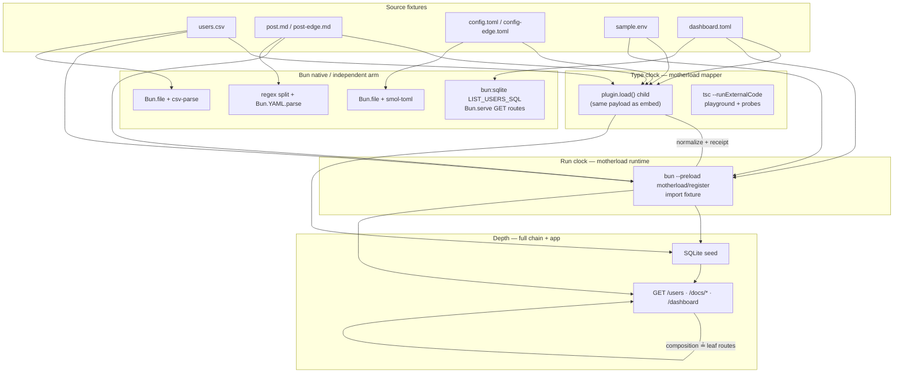

# Architecture and contract surface

Organized by **pillar** (source / motherload / Bun) so the framing survives milestone reshuffles. Milestone checklists live in [MILESTONES.md](./MILESTONES.md).

## Claim

Every shared fixture import is both a TypeScript contract and a runtime module; CI keeps mapper and runtime equivalent; receipts are deterministic and redacted; Range composition preserves the same values through leaf routes.

## Three pillars

| Pillar | Role in the stack | What this repo adds |
|--------|-------------------|---------------------|
| **Source (fixtures)** | Committed static files under `playground/fixtures/` (+ app paths where shared, e.g. `users.csv`) | Same path at **type time** (mapper) and **run time** (preload); mapper cache keyed by `(path, importKind)` only — never mtime; adversarial ordering where it matters (Zelda-first CSV) |
| **Motherload @0.1.0** | TS 7.1 `contentMappers` + `bun --preload motherload/register` | **Two-clock parity:** isolated `plugin.load()` child ≟ preload import child (`contracts/*`, `rules.ts`). App CSV: preload ≟ SQLite seed (`ORDER BY rowid`) |
| **Bun native** | Loaders, `Bun.file`, `bun:sqlite`, `Bun.serve`, `process.loadEnvFile`, `Bun.YAML.parse` | **Independent-parser arms** where Bun has no CSV / typed-TOML / frontmatter import story; live app is Bun-only. `Bun.markdown` is a renderer, not a `{ md, frontmatter }` parser ([oven-sh/bun#26605](https://github.com/oven-sh/bun/issues/26605)) |

## Two clocks and HTTP entry

Contract harness details: [contracts/README.md](../contracts/README.md).

## Contract surface by pillar

| Layer | Test / artifact | Source | Motherload | Bun native |
|-------|-----------------|--------|------------|------------|
| File parity (M1) | `contracts/*.parity.test.ts` + `rules.ts` | manifest fixtures | mapper ≟ preload | normalizer in harness |
| CSV two-clock | `csv-two-clock.parity.test.ts` | `users.csv` | both arms | `native-csv-child` (no preload) |
| TOML two-clock | `toml-two-clock.parity.test.ts` | `config-edge.toml` (edge) | mapper arm | smol-toml child |
| TOML shape divergence | `toml-bun-native-shape.parity.test.ts` | `config-edge.toml` | ISO string datetimes | `Bun.TOML.parse` → `Temporal` (not normalized) |
| MD two-clock | `md-two-clock.parity.test.ts` | `post.md`, `post-edge.md` | mapper arm | YAML + split (not `Bun.markdown`) |
| Storage fidelity | `app-csv-motherload-sqlite.parity.test.ts` | same CSV | preload import | SQLite TEXT + `ORDER BY rowid` |
| Full chain | `app-csv-full-chain.parity.test.ts` | Zelda-first CSV | canonical sort expectation | `LIST_USERS_SQL` ≟ `GET /users` |
| Range | `app-dashboard-composition.parity.test.ts` | `dashboard.toml` | union type probe | static `loadDashboard()`; panels ≟ leaf GETs |
| Hardening (M4) | receipt + secret tests, `scripts/test-contracts.ts` | — | — | deterministic `Bun.inspect`, CI artifacts on failure |
| Curriculum | `playground/layers/*` | motherload `lab/basic` | types + runtime demo | layer 08 notes Bun attrs vs motherload |

## Fixture routing (app-path vs edge)

| Fixture | Consumer | Two-clock / proof |
|---------|----------|-------------------|
| `users.csv` | `db.ts` → `/users`, dashboard users panel | csv-parse; full-chain + `LIST_USERS_SQL` |
| `post.md` | `docs.ts` → `/docs/:slug` | YAML + split |
| `config-edge.toml` | not in app | smol-toml two-clock; Bun native shape arm (see below) |
| `post-edge.md` | not in app | date / multiline YAML edge |
| `sample.env` | `loadEnvFile` | `rules.env`, redaction canary |
| `dashboard.toml` | startup `/dashboard` | discriminated union probe; frozen at startup (POST `/users` does not refresh dashboard) |

**Fixture co-ownership:** `users.csv` is co-owned by layer 05 (curriculum) and `db.ts` (app seed). Adding a column for one consumer changes the other. If they diverge, split into `users.csv` (curriculum) + `users.app.csv` (seed) rather than branching the fixture.

## Four lenses

| Lens | Where it shows up |
|------|-------------------|
| **Altitude** | Type clock (mapper + probes) predicts client/runtime shapes |
| **Depth** | Mapper ≟ SQLite ≟ HTTP; adversarial CSV; loader conformance |
| **Range** | `dashboard.toml` composition ≟ leaf routes; **depth-1 only** (no nested dashboard refs) |
| **Speed** | Agent + `ci:local` / GHA artifacts (not a separate benchmark story) |

## Cross-cutting invariants

| Invariant | Rule |
|-----------|------|
| Mapper cache | Key = `(path, importKind)` only, process lifetime; fixtures static — no mtime invalidation |
| CSV columns | Stay `TEXT` in SQLite until M3 schema-inference policy reopens |
| Composition | Depth-1 refs in `dashboard.toml` only |
| Receipts | Deterministic, redacted; failure artifacts under `artifacts/contracts/` (not raw stdout) |
| App parity spawns | `DB_PATH=:memory:`, `PORT=0` |

### Fragile invariant — users order triad

SQL cannot run inside the mapper host or the bare test host, so user sort order is encoded in three places. Change one → change all three deliberately; parity tests fail until you do.

| Encoding | Where | Role |
|----------|-------|------|
| **`LIST_USERS_SQL`** | `examples/config-server/db.ts` | Source of truth for serve order |
| **`orderUserRowsLikeListUsersSql()`** | `db.ts` | Mapper-side expectations (preload-free hosts) |
| **`canonicalServeOrder()`** | full-chain parity test | Test host expectation (literal sort — not derived from SQL at runtime) |

## Known limitations and deferred work

Framing: **maintenance, not thesis** — the claim is intact; items below are not holes in the falsifiability story.

### TOML — three parsers, datetime shape divergence

On `config-edge.toml`, **motherload mapper** and **smol-toml** agree: offset datetimes are **ISO strings** (e.g. `"1979-05-27T07:32:00.000Z"`). **`Bun.TOML.parse`** parses the same file but returns **`Temporal.Instant`** for offset date-times; `toJSON()` yields `"1979-05-27T07:32:00Z"` (no `.000` ms). That is a **known shape divergence**, tested in `toml-bun-native-shape.parity.test.ts`, **not** smoothed by `rules.toml.normalize`. Migrating from motherload preload to `Bun.TOML.parse` changes datetime field types at runtime.

**`config.toml`** (app) is **single-parser by construction**: lossless bigint and mixed-type arrays — neither smol-toml nor `Bun.TOML.parse` can confirm it on the external arm. **`config-edge.toml`** covers the parseable cross-parser surface (underscore int, datetimes, inline table, standard table).

### Known limitations (by construction or external)

| Item | Notes |
|------|--------|
| **`sample.env` side-effect contract** | By construction — env loading is not an external-parser two-clock; covered via `rules.env` |
| **`Bun.markdown` #26605** | Upstream; watch for native frontmatter; MD arm stays split + `Bun.YAML.parse` until then |
| **Redis / WS (M2)** | Conditional arms are intentionally partial when `REDIS_URL` unset |
| **`test:artifacts` meta-test** | Optional — artifact file writes are untested; values inside receipts already covered by M4.1 / M4.2 |

### Deferred — small (claim queued, not broken)

| Item | Notes |
|------|--------|
| **Layer 08 attribute arm** | Real two-clock claim waiting: plain `.json` with `with { type: "json" }` ≟ mapper path — one test file, no new devDeps (`playground/layers/08-bun-import-attributes.ts`) |

## What next (maintenance checklist)

1. **Re-pin discipline** — `typescript@beta` and `motherload@0.1.0`; run `bun run ci:local` after any pin change ([contracts/README.md](../contracts/README.md)).
2. **Fixture co-ownership** — treat `users.csv` edits as affecting layer 05 and app seed together, or split fixtures (see above).
3. **Watch #26605** — if Bun gains frontmatter on `Bun.markdown`, revisit MD two-clock tiering.

Not planned: depth-2 `dashboard.toml` composition (tractability of the Range claim).
